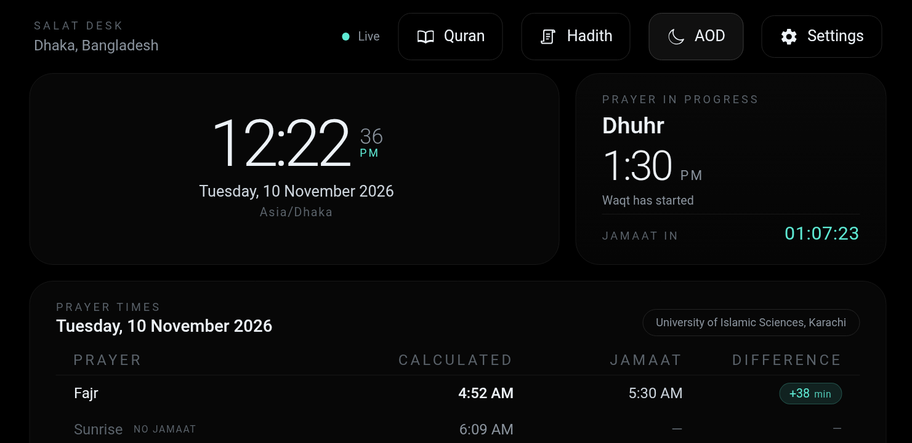
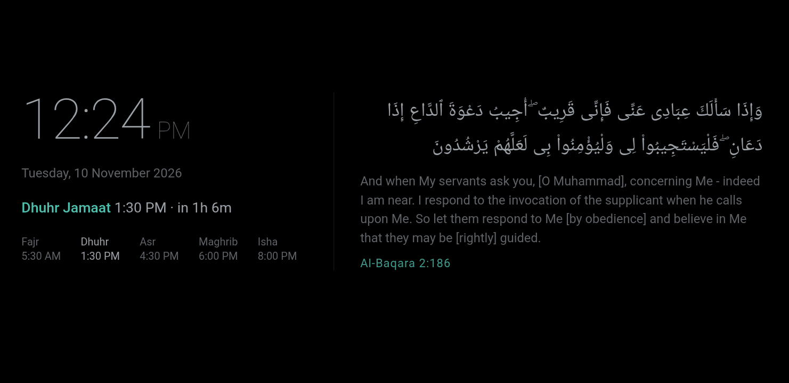
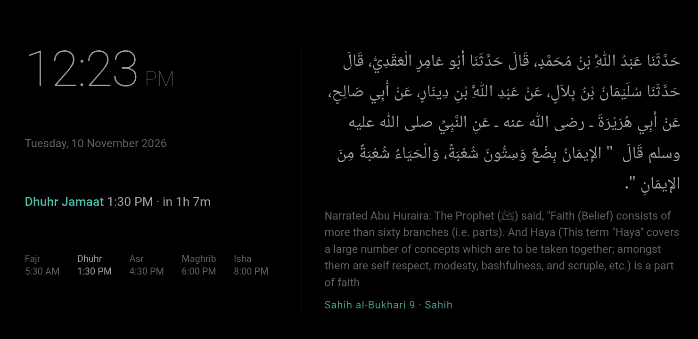
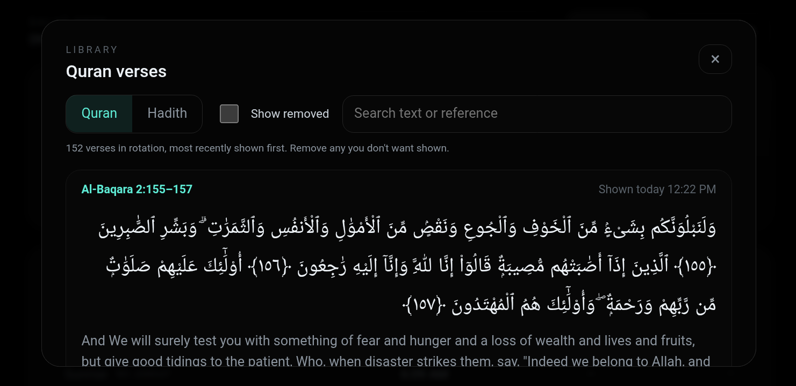
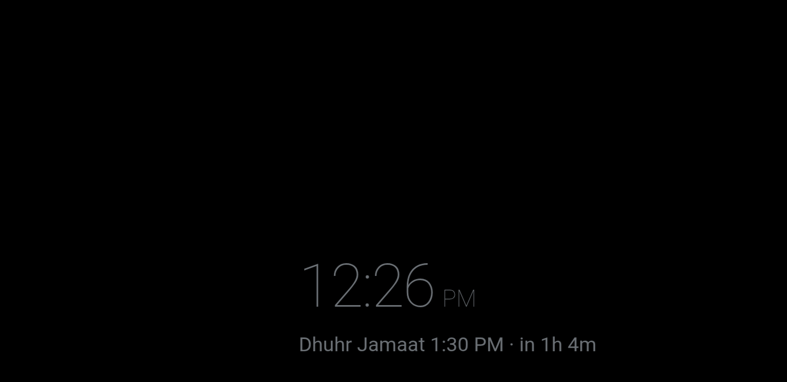
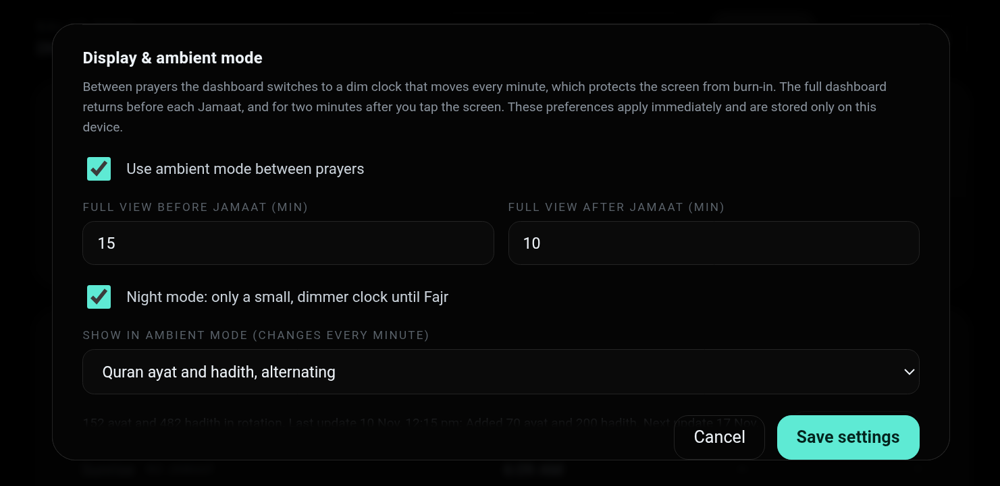

# Salat Desk

**Turn an old Android phone into an always-on prayer clock for your desk.**

Salat Desk shows today's prayer times, your mosque's Jamaat times and a live countdown. Between prayers it
switches to a dim, slowly moving clock with a new Quran ayah or hadith every minute, designed to stay on all day
without burning in an AMOLED screen. It runs entirely on the phone: no account, no server, no ads, and it works
offline.

  
  

## Features

- **Prayer times, calculated on the phone.** Fajr, Sunrise, Dhuhr, Asr, Maghrib and Isha for your location,
  with a choice of calculation method (Karachi, Muslim World League, ISNA, Egyptian, Dubai, Kuwait, Singapore,
  Moonsighting Committee, or your own angles), Hanafi or Standard Asr, and per-prayer minute adjustments.
- **Your mosque's Jamaat times.** Enter the timetable once (it can change from a chosen date). Salat Desk checks that
  each Jamaat falls inside its prayer window and shows the difference from the calculated start.
- **Countdown and Jamaat warning.** Counts down to the next Waqt or Jamaat. Before each Jamaat (10 minutes by default,
  your choice for each prayer) a red frame blinks around the screen, also in the always-on view, with the time left to
  the second.
- **Notifications.** For each prayer you choose, the phone shows a notification when its warning starts, with
  vibration and the notification light where the phone has one, even while Salat Desk is in the background.
- **Always-on display, made for old phones.** Between prayers the screen dims to a grey clock on pure black that
  moves to a new spot every minute, so no pixel stays lit. The full dashboard returns 15 minutes before each Jamaat.
  From 23:00 until Fajr a smaller, dimmer night clock is shown.
- **A new Quran ayah or hadith every minute.** Arabic with English translation and the exact reference, alternating
  between Quran and Hadith. A text is shown only when it fits the screen completely, never cut off.
- **New content every week.** About 70 new ayat and 200 new hadith are downloaded once a week over Wi-Fi and kept on
  the phone.
- **Your choice of verses.** Read everything in the Quran and Hadith library, most recently shown first, and remove
  anything you don't want shown (you can restore it later).
- **AOD button.** One tap switches to the always-on view straight away.

  
  

  
  

## Install

Salat Desk is not on Google Play yet. To install it on an Android phone (Android 7.0 or newer):

1. On the phone, open the [latest release](../../releases/latest) and download `SalatDesk-<version>.apk`.
2. Open the downloaded file. If Android asks, allow your browser or file manager to **install unknown apps**.
3. Tap **Install**, then open **Salat Desk**.

The APK is signed by the project; Android will only accept future updates signed with the same key.

## First-time setup

Tap **Settings** (gear icon):

1. **Location**: search for your city, or enter latitude, longitude and time zone (for example `Asia/Dhaka`).
2. **Calculation**: choose the method and Asr juristic method your mosque follows. Use **Manual adjustments** to
   match its printed timetable.
3. **Mosque Jamaat timetable**: enter the Jamaat times and the date they start. Each field shows the allowed range.
4. **Jamaat alerts**: for each prayer, turn the notification on or off and set how many minutes before the Jamaat the
   warning starts (up to the time between the Waqt and the Jamaat). On Android 13 and newer the phone asks once
   whether Salat Desk may show notifications.
5. **Display & ambient mode**: adjust when the full view appears around Jamaat, the night start time, brightness, and
   whether to show Quran, Hadith or both.

Then leave the phone on its charger. The screen stays on while Salat Desk is open.

> Calculated prayer times are astronomical estimates, not a religious authority. Always follow your local mosque.

## Using it every day

| Want to… | Do this |
| --- | --- |
| See the full dashboard | Tap the screen. It stays for 2 minutes after your last touch. |
| Switch to the always-on view now | Tap the **moon** (AOD) button. |
| Read past verses or hadith | Tap the **book** (Quran) or **scroll** (Hadith) button. |
| Stop a verse or hadith from appearing | Open the library and tap **Remove from rotation**. Turn on **Show removed** to restore it. |
| Get this week's new content now | Settings → Display & ambient mode → **Update now** (on Wi-Fi). |
| See the system bars | Swipe from the top or bottom edge. |

### Looking after an old phone

- AMOLED screens (most Samsung phones) switch black pixels off, so the dark design uses very little power and
  spreads wear across the screen.
- If your phone or custom ROM supports a **charge limit** (for example 85 %), turn it on: a phone that stays on its
  charger all the time ages its battery faster.
- Salat Desk only changes the brightness of its own window; your phone's brightness setting is untouched.
- Most phones blink the notification light only while the screen is off. After a restart, open Salat Desk once so it
  can schedule the Jamaat notifications again.

## Privacy

- No account, no analytics, no ads.
- Your location, settings and timetable stay on the phone. Jamaat notifications are created by the phone itself; no
  push service is involved.
- The app connects to the internet only to search for a city (Open-Meteo) and for the weekly Ayat/Hadith download
  (AlQuran.cloud and the hadith-api on jsDelivr). Prayer times are calculated offline.

Full privacy policy: [PRIVACY.md](PRIVACY.md).

## Credits

- Quran Arabic text: [Tanzil.net](https://tanzil.net) (Uthmani). English: Sahih International. Both via
  [AlQuran.cloud](https://alquran.cloud).
- Hadith: [fawazahmed0/hadith-api](https://github.com/fawazahmed0/hadith-api), from Sahih al-Bukhari, Sahih Muslim,
  An-Nawawi's Forty Hadith and Forty Hadith Qudsi.
- Prayer calculation: the [Adhan](https://github.com/stankovski/adhan-csharp) library.
- City search: [Open-Meteo](https://open-meteo.com).

See [NOTICE](NOTICE) for details.

## For developers

Salat Desk is a .NET MAUI app with a shared HTML/JavaScript dashboard and a C# core, with tests for both. Build
instructions, the architecture and the release process are in **[docs/DEVELOPMENT.md](docs/DEVELOPMENT.md)**.

Contributions and issue reports are welcome. The source code is released under the [MIT License](LICENSE); the Quran
and Hadith texts keep their own terms (see [NOTICE](NOTICE)).
